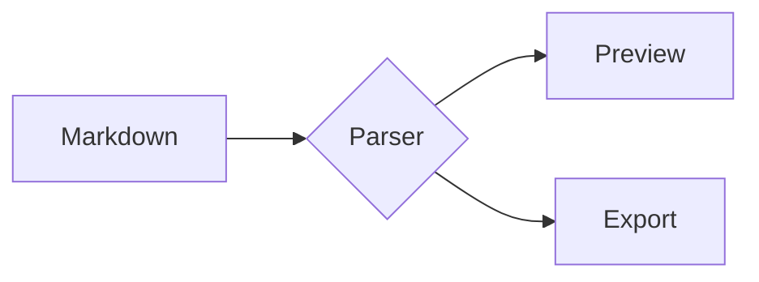

# GFM Syntax Checklist

A catalog of GitHub Flavored Markdown (GFM) syntax for checking how the Bokuchi preview renders each construct. Sections 1–20 follow the [GFM spec](https://github.github.com/gfm/); section 21 onward covers GitHub features that are outside the spec.

---

## 1. Headings

### ATX headings

# Heading level 1
## Heading level 2
### Heading level 3
#### Heading level 4
##### Heading level 5
###### Heading level 6

####### Seven hashes is not a heading

#No space after the hash is not a heading

## Closing hashes are stripped ##

### Heading with *emphasis*, `code` and a [link](https://github.com)

### Setext headings

Setext heading level 1
======================

Setext heading level 2
----------------------

---

## 2. Paragraphs and line breaks

This is the first paragraph. A single newline in the source
does not start a new line; it is a soft break and joins as a space.

This is the second paragraph, separated by a blank line.

Hard break with two trailing spaces  
continues on a new line.

Hard break with a trailing backslash\
continues on a new line.

---

## 3. Emphasis

| Syntax | Result |
|--------|--------|
| `*italic*` | *italic* |
| `_italic_` | _italic_ |
| `**bold**` | **bold** |
| `__bold__` | __bold__ |
| `***bold italic***` | ***bold italic*** |
| `___bold italic___` | ___bold italic___ |
| `**bold with *nested italic* inside**` | **bold with *nested italic* inside** |
| `*italic with **nested bold** inside*` | *italic with **nested bold** inside* |

Intraword emphasis: un*frigging*believable is emphasized, snake_case_word is not.

Not emphasis: 2 * 3 * 4 and a * b * c (asterisks surrounded by spaces).

---

## 4. Strikethrough (GFM extension)

~~Two tildes strike through~~

~One tilde also strikes through~

Mixed: **bold ~~bold struck~~** and ~~struck *italic struck*~~

~~~Three tildes are not strikethrough~~~

---

## 5. Blockquotes

> A single-line quote.

> A multi-line quote
> spanning two source lines.
>
> A second paragraph in the same quote.

> A lazy continuation line
without the marker still belongs to the quote.

> Level 1
>
> > Level 2
> >
> > > Level 3

> ### Heading inside a quote
>
> - list item one
> - list item two
>
> ```js
> const quoted = true;
> ```
>
> **Bold**, *italic* and `code` inside a quote.

---

## 6. Bullet lists

Dash marker:

- Item one
- Item two
- Item three

Asterisk marker:

* Item one
* Item two

Plus marker:

+ Item one
+ Item two

Nested:

- Level 1
  - Level 2
    - Level 3
      - Level 4
- Back to level 1

Loose list (blank lines between items):

- First item

- Second item

- Third item

List item with multiple blocks:

- First paragraph of the item.

  Second paragraph of the same item.

  ```js
  console.log("code block inside a list item");
  ```

  > Quote inside a list item

- Next item

---

## 7. Ordered lists

1. First
2. Second
3. Third

Starting from another number:

5. Five
6. Six
7. Seven

All numbered `1.` (renders 1, 2, 3):

1. First
1. Second
1. Third

Parenthesis delimiter:

1) First
2) Second

Nested and mixed:

1. Step one
   1. Sub-step a
   2. Sub-step b
2. Step two
   - Bullet under a number
   - Another bullet
3. Step three

---

## 8. Task lists (GFM extension)

- [x] Checked item
- [X] Checked with an uppercase X
- [ ] Unchecked item
- [ ] Item with **bold**, `code` and a [link](https://github.com)
  - [x] Nested checked item
  - [ ] Nested unchecked item

1. [x] Task in an ordered list
2. [ ] Another task in an ordered list

- [] Missing space is not a task
- [x]No space after the bracket is not a task

---

## 9. Code spans

Inline `code` in a sentence.

A backtick inside: ``code with a ` backtick``

Double backticks inside: ```code with `` two backticks```

HTML is not interpreted: `<div class="x">&amp;</div>`

Markdown is not interpreted: `**not bold** and [not a link](x)`

Leading and trailing spaces are stripped once: `` `wrapped in backticks` ``

---

## 10. Fenced code blocks

Backtick fence without a language:

```
plain fenced block
  indentation is preserved
```

With a language:

```javascript
function add(a, b) {
  return a + b; // comment
}
```

```python
def add(a: int, b: int) -> int:
    return a + b
```

```json
{ "name": "bokuchi", "version": "1.2.0", "nested": { "ok": true } }
```

```diff
- removed line
+ added line
  unchanged line
```

Tilde fence:

~~~bash
echo "tilde fence"
~~~

A longer fence containing a shorter one:

````markdown
```js
const nested = "the inner fence is shown literally";
```
````

HTML and Markdown are shown literally:

```html
<p>**not bold** &amp; <em>not interpreted</em></p>
```

---

## 11. Indented code blocks

A paragraph, then four spaces of indentation:

    indented code block
      extra indentation is preserved
    <b>HTML is literal</b>

---

## 12. Tables (GFM extension)

Basic:

| Name | Role | City |
|------|------|------|
| Alice | Developer | Tokyo |
| Bob | Designer | Osaka |

Alignment:

| Left | Center | Right | Default |
|:-----|:------:|------:|---------|
| a | b | c | d |
| long left text | long center text | long right text | long default text |
| 1 | 2 | 3 | 4 |

Inline content in cells:

| Syntax | Result |
|--------|--------|
| Bold | **bold** |
| Italic | *italic* |
| Strikethrough | ~~struck~~ |
| Code | `code` |
| Link | [GitHub](https://github.com) |
| Escaped pipe | a \| b |
| Pipe in code | `a \| b` |
| Line break | line one<br>line two |

Without leading and trailing pipes:

Key | Value
--- | ---
one | 1
two | 2

Uneven rows (short rows are padded, extra cells are dropped):

| A | B | C |
|---|---|---|
| only one |
| one | two | three | four |

Header only:

| Header one | Header two |
|------------|------------|

---

## 13. Links

Inline link: [GitHub](https://github.com)

Inline link with a title: [GitHub](https://github.com "Hover title")

Angle-bracket destination: [link with spaces](<https://example.com/a b>)

Full reference link: [Bokuchi repository][bokuchi]

Collapsed reference link: [bokuchi][]

Shortcut reference link: [bokuchi]

Case-insensitive reference: [Bokuchi repository][BOKUCHI]

Link to a heading in this file: [jump to Tables](#12-tables-gfm-extension)

Relative link: [the table sample](./table.md)

Link text with formatting: [**bold** and `code` link](https://github.com)

Undefined reference stays literal: [missing][nope]

[bokuchi]: https://github.com/Bokuchi-Editor/bokuchi "Bokuchi Editor on GitHub"

---

## 14. Autolinks

Angle-bracket autolinks:

<https://github.com>

<mailto:user@example.com>

<user@example.com>

Extended autolinks (GFM extension, no angle brackets):

https://github.com/Bokuchi-Editor/bokuchi

http://example.com/path?query=1&other=2#fragment

www.example.com

user@example.com

Trailing punctuation is excluded: see https://github.com. Also (https://github.com) and https://github.com/a_b_c!

---

## 15. Images

Inline image:


Image with a title:


Reference image:

![Bokuchi icon][icon]

Image wrapped in a link:

[](https://github.com/Bokuchi-Editor/bokuchi)

Missing image (alt text or a broken-image placeholder):


[icon]: ../images/bokuchi-icon.png "Reference image title"

---

## 16. Thematic breaks

Three hyphens:

---

Three asterisks:

***

Three underscores:

___

With spaces:

- - -

---

## 17. Backslash escapes

\*not italic\* \_not italic\_ \*\*not bold\*\*

\# not a heading

\- not a list item

1\. not an ordered list

\[not a link\](https://example.com)

\`not code\`

\<not-a-tag\>

Literal backslash: \\

All escapable punctuation: \! \" \# \$ \% \& \' \( \) \* \+ \, \- \. \/ \: \; \< \= \> \? \@ \[ \\ \] \^ \_ \` \{ \| \} \~

A backslash before other characters stays: \a \z \1

---

## 18. Entity and numeric character references

| Source | Result |
|--------|--------|
| `&amp;` | &amp; |
| `&lt;` | &lt; |
| `&gt;` | &gt; |
| `&quot;` | &quot; |
| `&copy;` | &copy; |
| `&nbsp;` | a&nbsp;b |
| `&hearts;` | &hearts; |
| `&#35;` | &#35; |
| `&#x1F600;` | &#x1F600; |
| `&notanentity;` | &notanentity; |

---

## 19. Raw HTML

Inline HTML: <kbd>Ctrl</kbd> + <kbd>S</kbd>, H<sub>2</sub>O, x<sup>2</sup>, <mark>marked</mark>, <u>underlined</u>, <span style="color: red;">styled span</span>

Line break tag: first line<br>second line

<details>
<summary>Click to expand</summary>

Hidden content with **Markdown** inside.

- item one
- item two

</details>

<div align="center">

Centered block with **Markdown** inside.

</div>

<table>
  <tr><th>HTML table</th><th>Header</th></tr>
  <tr><td>cell</td><td>cell</td></tr>
</table>

<!-- This HTML comment must not be visible in the preview -->

---

## 20. Disallowed raw HTML (GFM extension)

GFM filters these tags: `<title>`, `<textarea>`, `<style>`, `<xmp>`, `<iframe>`, `<noembed>`, `<noframes>`, `<script>`, `<plaintext>`. None of the lines below may execute, restyle the page, or embed a frame.

<script>document.title = "script executed";</script>

<style>body { background: red !important; }</style>

<iframe src="https://example.com"></iframe>

<textarea>textarea content</textarea>

<title>title content</title>

---

## 21. Footnotes (GitHub feature, not in the spec)

Here is a simple footnote[^1], and here is a named one[^note].

The same footnote can be referenced twice[^1].

[^1]: The first footnote.
[^note]: A named footnote with **formatting** and `code`.

    A second paragraph, indented to stay inside the footnote.

---

## 22. Alerts (GitHub feature, not in the spec)

> [!NOTE]
> Useful information that users should know, even when skimming content.

> [!TIP]
> Helpful advice for doing things better or more easily.

> [!IMPORTANT]
> Key information users need to know to achieve their goal.

> [!WARNING]
> Urgent info that needs immediate user attention to avoid problems.

> [!CAUTION]
> Advises about risks or negative outcomes of certain actions.

---

## 23. Emoji shortcodes (GitHub feature, not in the spec)

Shortcodes: :smile: :rocket: :tada: :+1: :warning:

Unicode emoji: 😄 🚀 🎉 👍 ⚠️

---

## 24. Math (GitHub feature, not in the spec)

Inline math: $E = mc^2$ and $\sqrt{a^2 + b^2}$

Block math:

$$
\int_{0}^{\infty} e^{-x^2} \, dx = \frac{\sqrt{\pi}}{2}
$$

Math code fence:

```math
\sum_{k=1}^{n} k = \frac{n(n+1)}{2}
```

---

## 25. Mermaid diagrams (GitHub feature, not in the spec)



---

## 26. Edge cases

Very long unbroken text: Loremipsumdolorsitametconsecteturadipiscingelitseddoeiusmodtemporincididuntutlaboreetdoloremagnaaliquautenimadminimveniamquisnostrudexercitationullamcolaborisnisiutaliquipexeacommodoconsequat

Very long URL: https://example.com/a/very/long/path/that/keeps/going/and/going/and/going/and/going/and/going/and/going/and/going/and/going/and/going/and/going/index.html?with=query&and=more

Emphasis next to punctuation: **bold**, *italic*; (**bold in parentheses**) "*quoted italic*"

Unclosed markers stay literal: **unclosed bold, *unclosed italic, ~~unclosed strikethrough, `unclosed code

Mixed scripts: English 日本語 中文 한국어 العربية עברית ไทย
