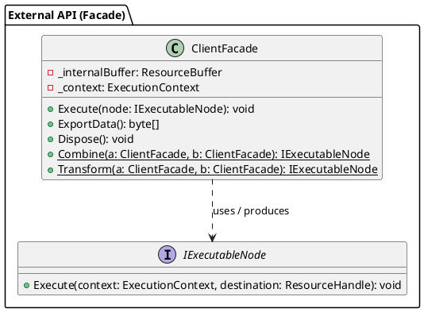
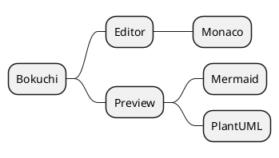
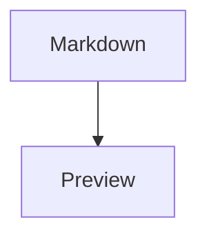
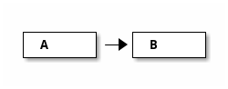

# PlantUML Diagram Samples

A collection of PlantUML diagrams to verify rendering in Bokuchi.

> Turn on Settings → Advanced → "PlantUML (Diagrams)" before previewing. When it is off, a notice at the top of the preview explains how to enable it.

## Class Diagram



## Sequence Diagram (no `@startuml`, `puml` identifier)

`@startuml` / `@enduml` are added automatically when omitted. The `puml` identifier also works.

```puml
actor User
participant "Auth Service" as A
User -> A : Login request
A --> User : Issue token
note right of A : A note
```

## Activity Diagram (`uml` identifier)

```uml
start
:Read file;
if (Is Markdown?) then (yes)
  :Render preview;
else (no)
  :Show raw;
endif
stop
```

## Mind Map

Start tags other than `@startuml`, such as `@startmindmap`, are passed through as-is.



## Coexistence with Mermaid



```plantuml
A -> B : hello
```

## Regular Code Blocks Are Unaffected

```javascript
const a = 1;
```

## Error Handling Test

The following block contains a syntax error. PlantUML's own error diagram is shown:

```plantuml
class A {
A -> ;;; B ->-> C
```

The next block is an unsupported diagram type (ditaa). An error box is shown:


