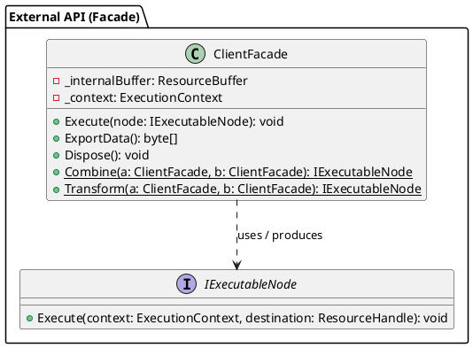
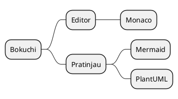
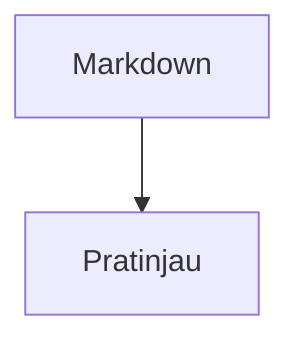
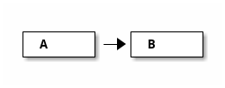

# Contoh Diagram PlantUML

Koleksi diagram PlantUML untuk memverifikasi rendering di Bokuchi.

> Aktifkan Pengaturan → Lanjutan → "PlantUML (Diagram)" sebelum melihat pratinjau. Saat nonaktif, pemberitahuan di bagian atas pratinjau menjelaskan cara mengaktifkannya.

## Diagram Kelas



## Diagram Sekuens (tanpa `@startuml`, pengenal `puml`)

`@startuml` / `@enduml` ditambahkan otomatis jika dihilangkan. Pengenal `puml` juga berfungsi.

```puml
actor Pengguna
participant "Layanan Autentikasi" as A
Pengguna -> A : Permintaan login
A --> Pengguna : Terbitkan token
note right of A : Sebuah catatan
```

## Diagram Aktivitas (pengenal `uml`)

```uml
start
:Baca berkas;
if (Apakah Markdown?) then (ya)
  :Render pratinjau;
else (tidak)
  :Tampilkan mentah;
endif
stop
```

## Peta Pikiran

Tag awal selain `@startuml`, seperti `@startmindmap`, diteruskan apa adanya.



## Berdampingan dengan Mermaid



```plantuml
A -> B : hello
```

## Blok Kode Biasa Tidak Terpengaruh

```javascript
const a = 1;
```

## Tes Penanganan Error

Blok berikut berisi kesalahan sintaks. Diagram error bawaan PlantUML akan ditampilkan:

```plantuml
class A {
A -> ;;; B ->-> C
```

Blok berikutnya adalah jenis diagram yang tidak didukung (ditaa). Kotak error akan ditampilkan:


