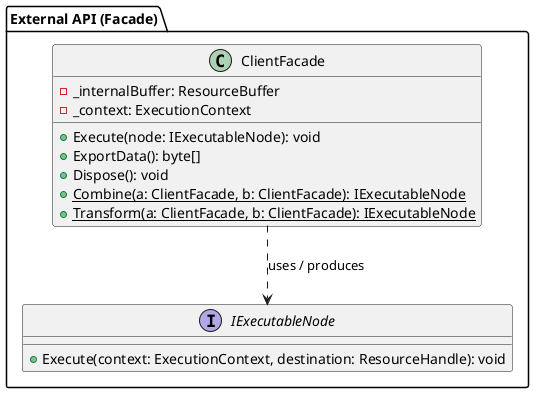
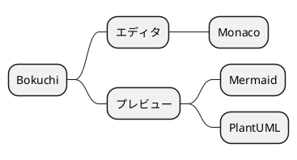
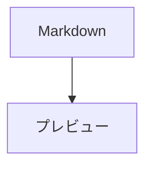
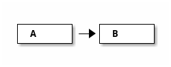

# PlantUML ダイアグラムサンプル

Bokuchi でのレンダリングを確認するための PlantUML ダイアグラム集です。

> 設定 → 高度な設定 → 「PlantUML（図表）」を ON にしてプレビューしてください。OFF のときはプレビュー上部に有効化の案内が表示されます。

## クラス図



## シーケンス図（`@startuml` 省略・識別子 `puml`）

`@startuml` / `@enduml` を省略すると自動的に補完されます。識別子は `puml` でも動作します。

```puml
actor 利用者
participant "認証サービス" as A
利用者 -> A : ログイン要求
A --> 利用者 : トークン発行
note right of A : 日本語のノート
```

## アクティビティ図（識別子 `uml`）

```uml
start
:ファイルを読み込む;
if (Markdown か?) then (はい)
  :プレビューを描画;
else (いいえ)
  :そのまま表示;
endif
stop
```

## マインドマップ

`@startmindmap` など `@startuml` 以外の開始タグもそのまま使えます。



## Mermaid との同居



```plantuml
A -> B : hello
```

## 通常のコードブロックは影響なし

```javascript
const a = 1;
```

## エラーハンドリングテスト

以下のブロックには構文エラーが含まれています。PlantUML 自身のエラー図が表示されます:

```plantuml
class A {
A -> ;;; B ->-> C
```

次のブロックは非対応の図（ditaa）です。エラーボックスが表示されます:


