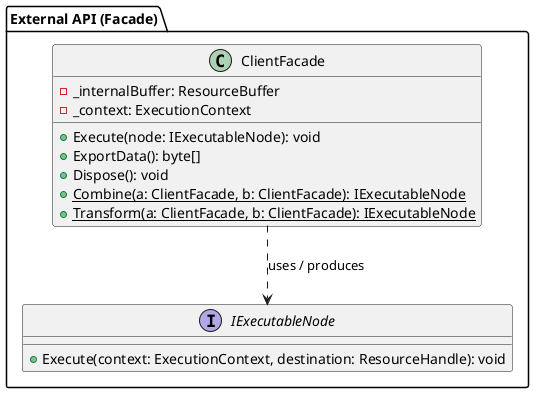
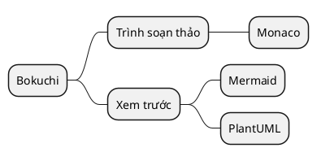
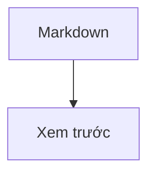
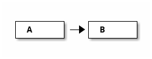

# Mẫu Biểu Đồ PlantUML

Bộ sưu tập các biểu đồ PlantUML để xác minh hiển thị trong Bokuchi.

> Hãy bật Cài đặt → Nâng cao → "PlantUML (Sơ đồ)" trước khi xem trước. Khi tắt, một thông báo ở đầu phần xem trước sẽ hướng dẫn cách bật.

## Biểu Đồ Lớp



## Biểu Đồ Tuần Tự (không có `@startuml`, định danh `puml`)

`@startuml` / `@enduml` sẽ được tự động thêm vào khi bị bỏ qua. Định danh `puml` cũng hoạt động.

```puml
actor "Người dùng" as U
participant "Dịch vụ xác thực" as A
U -> A : Yêu cầu đăng nhập
A --> U : Cấp token
note right of A : Một ghi chú
```

## Biểu Đồ Hoạt Động (định danh `uml`)

```uml
start
:Đọc tệp;
if (Là Markdown?) then (có)
  :Hiển thị xem trước;
else (không)
  :Hiển thị thô;
endif
stop
```

## Sơ Đồ Tư Duy

Các thẻ bắt đầu khác `@startuml`, chẳng hạn `@startmindmap`, được giữ nguyên.



## Dùng Chung Với Mermaid



```plantuml
A -> B : hello
```

## Khối Mã Thông Thường Không Bị Ảnh Hưởng

```javascript
const a = 1;
```

## Kiểm Tra Xử Lý Lỗi

Khối sau chứa lỗi cú pháp. Biểu đồ lỗi của chính PlantUML sẽ được hiển thị:

```plantuml
class A {
A -> ;;; B ->-> C
```

Khối tiếp theo là loại biểu đồ không được hỗ trợ (ditaa). Một hộp lỗi sẽ được hiển thị:


