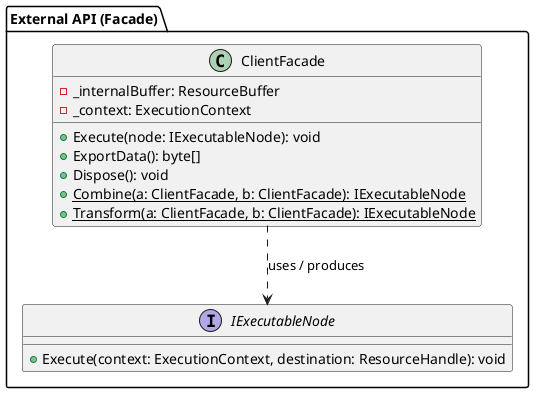
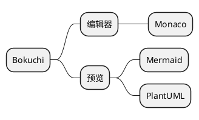
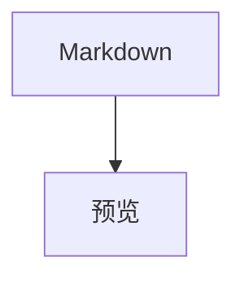
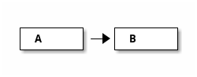

# PlantUML 图表示例

用于验证 Bokuchi 中 PlantUML 图表渲染效果的示例集合。

> 预览前请先开启 设置 → 高级 → “PlantUML（图表）”。关闭时，预览顶部会显示启用方法的提示。

## 类图



## 时序图（省略 `@startuml`、使用 `puml` 标识符）

省略 `@startuml` / `@enduml` 时会自动补全。标识符 `puml` 同样有效。

```puml
actor 用户
participant "认证服务" as A
用户 -> A : 登录请求
A --> 用户 : 签发令牌
note right of A : 中文注释
```

## 活动图（`uml` 标识符）

```uml
start
:读取文件;
if (是 Markdown 吗?) then (是)
  :渲染预览;
else (否)
  :显示原文;
endif
stop
```

## 思维导图

`@startmindmap` 等 `@startuml` 以外的起始标签会原样传递。



## 与 Mermaid 共存



```plantuml
A -> B : hello
```

## 普通代码块不受影响

```javascript
const a = 1;
```

## 错误处理测试

以下代码块包含语法错误，将显示 PlantUML 自身的错误图：

```plantuml
class A {
A -> ;;; B ->-> C
```

下一个代码块是不支持的图表类型（ditaa），将显示错误框：


