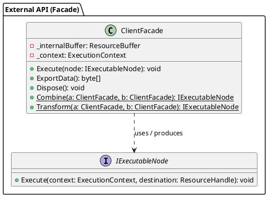
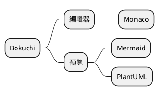
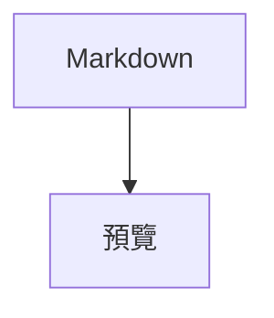
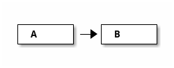

# PlantUML 圖表範例

用於驗證 Bokuchi 中 PlantUML 圖表渲染效果的範例集。

> 預覽前請先開啟 設定 → 進階 → 「PlantUML（圖表）」。關閉時，預覽頂部會顯示啟用方式的提示。

## 類別圖



## 循序圖（省略 `@startuml`、使用 `puml` 識別字）

省略 `@startuml` / `@enduml` 時會自動補全。識別字 `puml` 同樣有效。

```puml
actor 使用者
participant "驗證服務" as A
使用者 -> A : 登入請求
A --> 使用者 : 發行權杖
note right of A : 中文註解
```

## 活動圖（`uml` 識別字）

```uml
start
:讀取檔案;
if (是 Markdown 嗎?) then (是)
  :渲染預覽;
else (否)
  :顯示原文;
endif
stop
```

## 心智圖

`@startmindmap` 等 `@startuml` 以外的起始標籤會原樣傳遞。



## 與 Mermaid 共存



```plantuml
A -> B : hello
```

## 一般程式碼區塊不受影響

```javascript
const a = 1;
```

## 錯誤處理測試

以下區塊包含語法錯誤，將顯示 PlantUML 自身的錯誤圖：

```plantuml
class A {
A -> ;;; B ->-> C
```

下一個區塊是不支援的圖表類型（ditaa），將顯示錯誤方塊：


